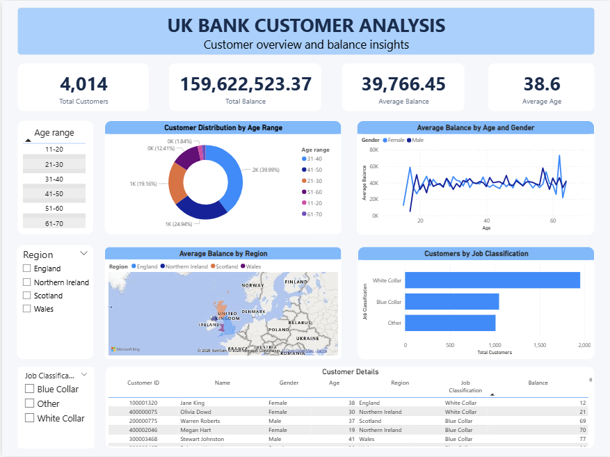

# UK Bank Customer Analysis

## Project Overview

This project analyzes UK bank customer data using Microsoft Power BI to explore customer demographics, regional distribution, job classifications, and customer balance patterns.

An interactive dashboard was developed to present key customer metrics and provide insights into customer characteristics and balance distribution.

## Project Objectives

The objectives of this project are to:

- Analyze customer distribution across different age groups.
- Examine customer distribution across regions.
- Understand customer composition by job classification.
- Explore average customer balance patterns by age and gender.
- Identify patterns and insights from customer demographic and balance data.
- Present analytical findings through an interactive Power BI dashboard.

## Key Business Questions

This analysis aims to answer the following questions:

1. Which age group has the largest number of customers?
2. Which region has the highest number of customers?
3. Which region has the highest average customer balance?
4. Which job classification has the largest customer population?
5. How does average customer balance vary across age and gender?

## Dataset

The dataset used in this project is **UK Bank Customers**, obtained from Kaggle.

**Source:** [UK Bank Customers – Kaggle](https://www.kaggle.com/datasets/ukveteran/uk-bank-customers)

The original dataset contains 4,014 records and 9 columns:

| Column | Description |
|---|---|
| Customer ID | Unique customer identifier |
| Name | Customer first name |
| Surname | Customer surname |
| Gender | Customer gender |
| Age | Customer age |
| Region | Customer region |
| Job Classification | Customer job category |
| Date Joined | Date the customer joined the bank |
| Balance | Customer account balance |

For more information about the dataset and how to obtain it, see [Data Documentation](data/README.md).

## Tools & Technologies

- Microsoft Power BI
- Power Query
- DAX (Data Analysis Expressions)
- CSV

## Data Preparation

Data preparation was performed using Power Query.

The main steps included:

1. Importing the customer dataset into Power BI.
2. Promoting the first row as column headers.
3. Setting appropriate data types for each column.
4. Combining the `Name` and `Surname` columns into a single `Name` column.
5. Creating an `Age range` column to categorize customers into age groups.
6. Reviewing the prepared dataset before loading it into the Power BI data model.

The age groups were defined as:

- 11–20
- 21–30
- 31–40
- 41–50
- 51–60
- 61–70
- 71+

After data preparation, the dataset contains 9 columns.

## Data Analysis (DAX Measures)

Four DAX measures were created to calculate the main customer metrics.

### 1. Total Customers

Counts the distinct number of customers based on their customer IDs.

```dax
Total Customers =
DISTINCTCOUNT('P6-UK-Bank-Customers'[Customer ID])
```

### 2. Total Balance

Calculates the total balance across customers.

```dax
Total Balance =
SUM('P6-UK-Bank-Customers'[Balance])
```

### 3. Average Balance

Calculates the average customer balance.

```dax
Average Balance =
AVERAGE('P6-UK-Bank-Customers'[Balance])
```

### 4. Average Age

Calculates the average age of customers.

```dax
Average Age =
AVERAGE('P6-UK-Bank-Customers'[Age])
```

## Dashboard Preview



## Dashboard Features

The interactive dashboard includes the following components.

### 1. Key Performance Indicators (KPIs)

- Total Customers
- Total Balance
- Average Balance
- Average Age

### 2. Customer Distribution by Age Range

A donut chart showing the distribution of customers across different age groups.

### 3. Average Balance by Age and Gender

A line chart comparing average customer balance across age and gender categories.

### 4. Average Balance by Region

A geographical visualization showing average customer balance across regions.

### 5. Customers by Job Classification

A bar chart showing the number of customers in each job classification.

### 6. Customer Details

A table displaying individual customer information, including customer ID, name, gender, age, region, job classification, and balance.

### 7. Interactive Filters

Users can explore the dashboard using the following filters:

- Age Range
- Region
- Job Classification

## Key Metrics

The following metrics represent the overall dataset before applying interactive filters.

| Metric | Value |
|---|---:|
| Total Customers | 4,014 |
| Total Balance | 159,622,523.37 |
| Average Balance | 39,766.45 |
| Average Age | 38.61 |

**Note:** The dataset does not explicitly specify the currency unit for the `Balance` column. Therefore, no currency symbol is assigned in this project.

## Key Insights

Based on the analysis of 4,014 customer records, the following insights were identified:

### 1. Customer Distribution by Age

The 31–40 age group represents the largest customer segment, with 1,605 customers (39.99% of the total customer base).

### 2. Customer Distribution by Region

England has the largest customer population, with 2,159 customers (53.79%), followed by Scotland with 1,124 customers (28.00%).

### 3. Average Balance by Region

Wales has the highest average customer balance at 42,390.06, exceeding the overall average balance of 39,766.45.

### 4. Customer Distribution by Job Classification

White Collar customers represent the largest job classification group, with 1,955 customers (48.70% of the total customer base).

## Business Recommendations

Based on the identified insights, the following recommendations can be considered:

1. **Customer Segmentation:** Consider developing customer segmentation strategies for different age groups, particularly the 31–40 age group, which represents the largest customer segment.

2. **Regional Analysis:** Conduct further analysis of customers in Wales to understand the factors associated with its higher average customer balance.

3. **Job-Based Customer Analysis:** Evaluate customer characteristics and potential service needs across job classifications, particularly the White Collar segment.

4. **Further Data Analysis:** Combine customer demographic data with transaction history, product usage, and customer activity data to gain deeper insights into customer behavior and business value.

## Conclusion

This project demonstrates the use of Microsoft Power BI to transform raw customer data into an interactive dashboard.

Through data preparation, DAX calculations, and data visualization, the analysis provides an overview of customer demographics, regional distribution, job classifications, and customer balance patterns.

The findings can serve as a starting point for further customer segmentation and business analysis.

## How to Use

1. Clone or download this repository.
2. Open the `.pbix` file in Microsoft Power BI Desktop.
3. Obtain the dataset from the original Kaggle source.
4. If Power BI requests the dataset location, update the source path to the downloaded CSV file.
5. Refresh the data in Power BI.
6. Explore the dashboard using the available interactive filters.

## Repository Structure

```text
uk-bank-customer-analysis/
├── README.md
├── power-bi/
│   └── UK_Bank_Customer_Analysis.pbix
├── images/
│   └── dashboard-preview.png
└── data/
    └── README.md
```

## Notes

- This project was developed as a Data Analytics portfolio project.
- The analysis is based on the dataset referenced above.
- Dataset usage and redistribution are subject to the original source's license and terms.

## Author

**https://github.com/abdullmalikrahman**

Data Analytics Portfolio Project
